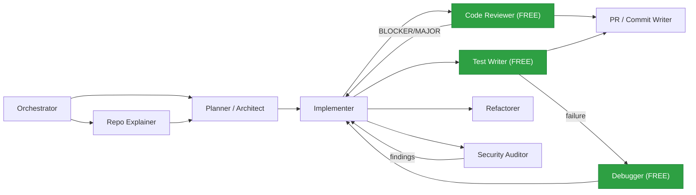

# coding-agent-prompts: honest code reviewer, debugger & test writer subagents for Claude Code, Cursor and AGENTS.md

[](LICENSE)
[](.claude/agents)
[](.cursor/rules)
[](AGENTS.md)
[](CHANGELOG.md)

Free, production-ready **system prompts for AI coding agents**: a severity-ranked **code reviewer**, a root-cause **debugger**, and a **test writer** that runs its tests before it reports on them. Each one ships as a native **Claude Code subagent**, a **Cursor rule**, and an **AGENTS.md** block (for Codex, GitHub Copilot, and other agents), and one command installs them.

They target the habits that make coding agents hard to trust: inventing APIs, burying the one real bug under 30 nits, patching symptoms instead of causes, and saying "all tests pass" without running anything.

## What's inside

| Role | What it does | Claude Code | Cursor | AGENTS.md |
|---|---|---|---|---|
| `code-reviewer` | Reviews a diff/PR. Findings ranked BLOCKER → NIT, each with `file:line` and a concrete failure scenario. Read-only. | `.claude/agents/code-reviewer.md` | `.cursor/rules/code-reviewer.mdc` | ✓ |
| `debugger` | Triage → reproduce → isolate → fix. Root cause marked CONFIRMED or SUSPECTED, plus a regression test. | `.claude/agents/debugger.md` | `.cursor/rules/debugger.mdc` | ✓ |
| `test-writer` | Behavior-focused, deterministic tests in your existing style. Runs them and reports real output. | `.claude/agents/test-writer.md` | `.cursor/rules/test-writer.mdc` | ✓ |

Plain-text versions for any other tool or API are in [`prompts/`](prompts).

## Install

From your project's root:

```bash
git clone https://github.com/ReefJedi/coding-agent-prompts.git /tmp/coding-agent-prompts
/tmp/coding-agent-prompts/install.sh            # detects your tool, or asks
```

Or pick the target yourself:

```bash
/tmp/coding-agent-prompts/install.sh claude     # .claude/agents/*.md
/tmp/coding-agent-prompts/install.sh cursor     # .cursor/rules/*.mdc
/tmp/coding-agent-prompts/install.sh agents     # appends a block to AGENTS.md
/tmp/coding-agent-prompts/install.sh all        # everything
```

The installer never overwrites your files unless you pass `--force`. Running it again on `AGENTS.md` replaces our block between the `coding-agent-prompts` markers and doesn't duplicate it.

**Use it**
- Claude Code: "Use the code-reviewer subagent on my staged changes", or let Claude call it automatically.
- Cursor: mention `@code-reviewer` in chat, or let the agent pick the rule from its description.
- AGENTS.md tools: "Act as the debugger role from AGENTS.md."

## The honesty rules

These rules are what set these prompts apart from generic "you are an expert" prompts:

1. **Never claim a check passed unless you ran it in this session and can quote the output.**
2. **Facts vs. suspicions.** "This throws when `items` is empty" only if verified. Otherwise "possible issue, verify X."
3. **No invented problems.** A clean change gets a short review that says it's clean. Max 3 nits.
4. **Root cause or it's not fixed.** A try/catch, null check, longer timeout, or retry at the crash site counts as a symptom fix unless it's justified.
5. **Never weaken a test to make a bug disappear.** If the code is wrong, report it as a bug.
6. **Say what you didn't do.** Too large to review? Blocked after several hypotheses? Report it and give the next step.

## The full pipeline

These three roles come from a 10-role pipeline built to work together:



## Get the full 10-role pipeline

The free roles stand on their own. If you want the whole team, the **[Coding Agent Prompt Pack](https://aiagentdecoder.gumroad.com/l/wylpq)** ($19) adds the **Orchestrator**, **Planner/Architect**, **Implementer**, **Refactorer**, **Security Auditor**, **PR/Commit Writer**, and **Repo Explainer**. They share the same honesty rules and are designed to hand work to each other. Each role includes recommended tools and settings, a worked example, and tips for adapting it.

Just want to try one first? The [free Code Reviewer download](https://aiagentdecoder.gumroad.com/l/axlmx) is the standalone version.

## FAQ

**Which models does this work with?** They're plain system prompts, so they work with any capable model. They do best with strong reasoning models at low temperature.

**Do the Claude Code subagents restrict tools?** Yes. `code-reviewer` gets read/search tools plus Bash (for `git diff`). Edit the `tools:` line to tighten or loosen this.

**Can I use these at work?** Yes. The files in this repo are MIT licensed.

## Contributing

Bug reports with transcripts are the most useful contribution. See [CONTRIBUTING.md](CONTRIBUTING.md) and [CHANGELOG.md](CHANGELOG.md).

## License

[MIT](LICENSE) for the files in this repository. The paid pack is licensed separately.

<sub>Keywords: Claude Code subagents, Cursor rules, .mdc, AGENTS.md, AI code review prompt, coding agent system prompt, debugging agent, test generation agent, Codex, GitHub Copilot instructions.</sub>
